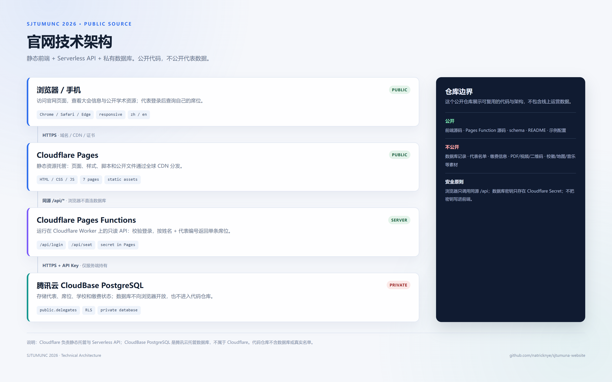
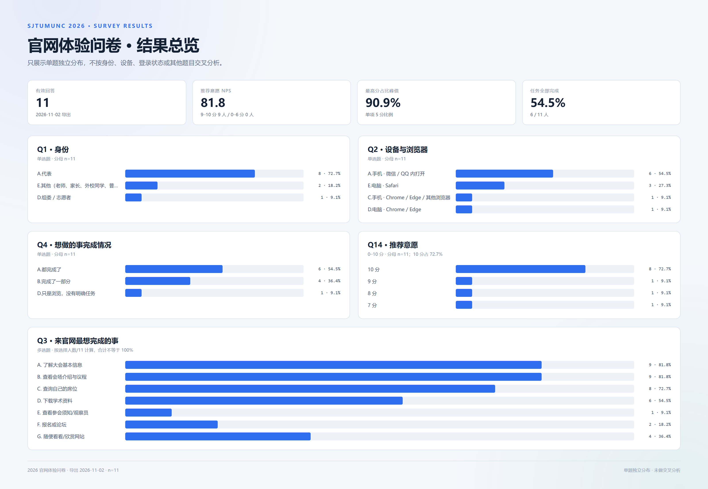
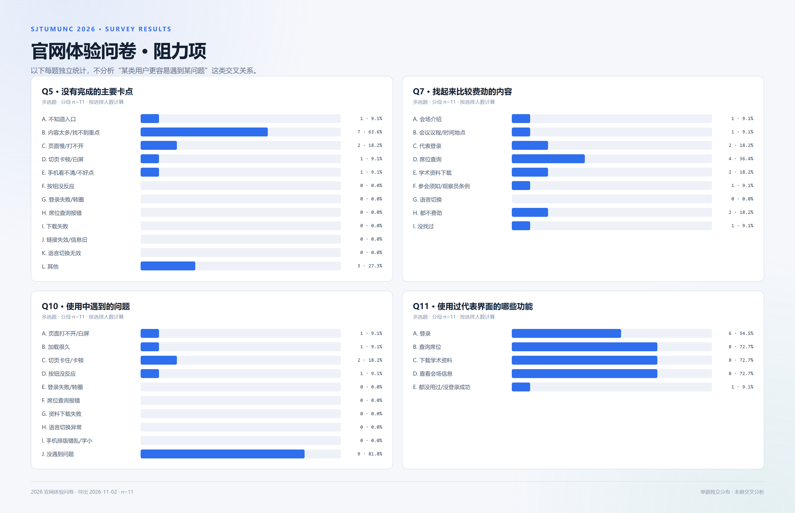
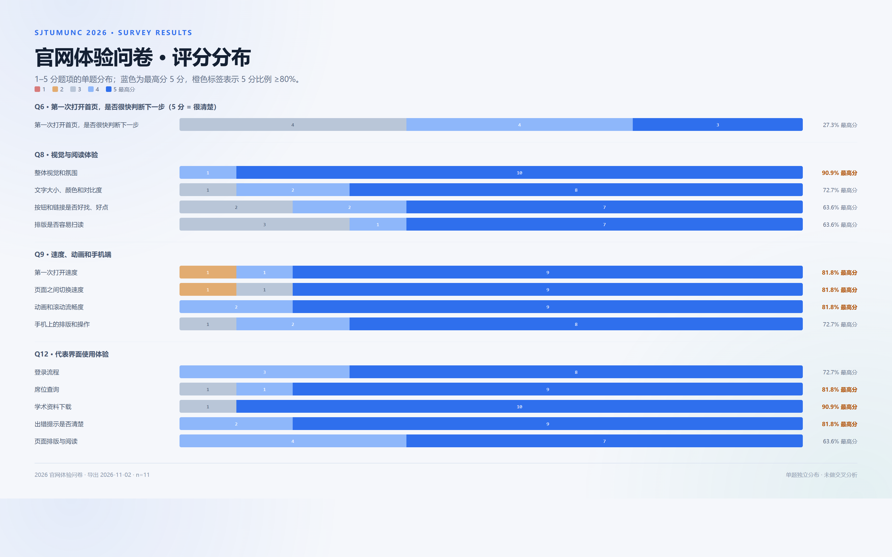
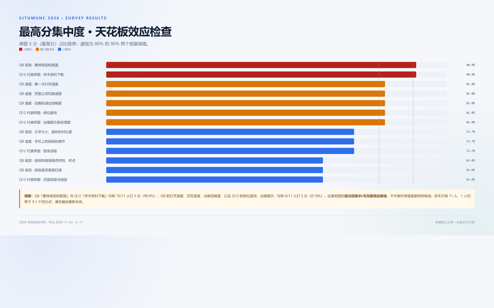

# SJTUMUNC 2026 官网 · 开源代码

**线上网站：** https://sjtumuna.pages.dev/

2026 上海交通大学南洋模拟联合国大会官网的源代码展示。  
这是一个**非官方学生项目**，与上海交通大学官方无隶属或背书关系。

> 本仓库只开放代码与架构，不包含线上数据库、真实代表名单或活动素材。

## 技术架构



## 技术栈

| 层级 | 技术 | 作用 |
|---|---|---|
| 前端 | 原生 HTML5 / CSS3 / JavaScript | 七个页面、响应式布局、中英文界面、会场资源与代表席位交互 |
| 静态托管 | Cloudflare Pages | 全球 CDN、HTTPS、页面与静态资源分发 |
| API | Cloudflare Pages Functions（Workers） | 同源只读接口 `/api/login`、`/api/seat`，服务端校验并查询数据库 |
| 数据库 | 腾讯云 CloudBase PostgreSQL | 私有 `public.delegates` 表，保存代表、席位、学校和缴费状态 |
| 部署 | Wrangler | 将静态站点与 Pages Function 一起部署 |
| 问卷 | 腾讯问卷（外部链接） | 官网体验反馈，不属于核心业务链路 |

没有使用 Vue、React、FastAPI 或 SQLite。前端是**无框架的原生 HTML/CSS/JS 静态站点**，由 Cloudflare Pages 直接托管；后端是 Cloudflare Serverless Function。

这里的“静态”指页面文件原样分发，没有 Node/Python 服务端渲染、没有前端框架构建、没有数据库直连；**不代表页面没有交互**。浏览器端 JavaScript 仍负责语言切换、会场展开、登录、席位查询、地图拖拽、视频和问卷弹窗等动态行为，需要数据时调用同源 `/api/*`。

## 作者注：AIGC 时代，Vue/React 过时了吗？

这是一个开放讨论，不是本项目的结论。

AIGC 确实降低了原生 HTML/CSS/JS 的编写和维护成本，也让“小站点不必默认引入框架、构建链和运行时依赖”变得更有吸引力。但这不等于 Vue/React 已经过时：组件化、状态管理、路由、可访问性、测试、团队协作和成熟生态，在中大型应用里仍然需要框架；AI 更适合在明确约束下生成组件，而不是替代架构决策。

本项目选择原生 JS，是因为页面数量有限、交互边界清晰、部署目标是静态 CDN。这是对场景的适配，不是对 Vue/React 的否定。真正值得重新思考的，可能是“每个项目都默认上框架”的习惯，而不是框架本身。

## 数据流

```text
浏览器 / 手机
    │  HTTPS
    ▼
Cloudflare Pages
    │  静态页面、CSS、JS、公开资源
    │  同源 /api/*
    ▼
Cloudflare Pages Functions
    │  /api/login  /api/seat
    │  API 密钥只存在服务端
    ▼
腾讯云 CloudBase PostgreSQL
    └─ public.delegates（私有）
```

关键原则：

- 浏览器**不直连数据库**，只调用同源 `/api/*`
- `CLOUDBASE_API_KEY` 只存放在 Cloudflare Pages Secret 中
- API 只返回当前姓名 + 代表编号匹配到的单条记录
- 数据库、真实名单、缴费信息和活动素材不进入公开仓库

## 目录结构

```text
.
├─ mun-site-v78/            # 静态前端源码
│  ├─ *.html                # 七个页面
│  ├─ *.css / *.js          # 样式、交互、登录、席位、问卷入口
│  ├─ _worker.js            # Cloudflare Pages Functions
│  ├─ cloudbase-config.example.js
│  └─ assets/README.md      # 素材说明（实际素材未包含）
│
├─ backend/                 # CloudBase 后端源码与建表 SQL
│  ├─ functions/
│  └─ schema*.sql
│
├─ docs/architecture.png    # 中文架构图
├─ README.md
├─ LICENSE                  # MIT（仅代码）
└─ CONTENT-NOTICE.md        # 素材/商标/内容授权说明
```

## 本地预览

```bash
# 在仓库根目录
python -m http.server 8402

# 打开
http://127.0.0.1:8402/mun-site-v78/
```

仓库只包含源码，没有活动 PDF、视频、二维码、校徽、地图、音乐和字体等素材；直接运行时这些资源会缺失。请放入你有权使用的文件到 `mun-site-v78/assets/`。

## 环境变量

复制示例配置：

```bash
cp mun-site-v78/cloudbase-config.example.js mun-site-v78/cloudbase-config.js
```

Cloudflare Pages Function 需要配置：

```text
CLOUDBASE_API_KEY=你的服务端密钥
CLOUDBASE_ENV_ID=你的 CloudBase 环境 ID
```

公开版本中的 `_worker.js` 使用 `YOUR_CLOUDBASE_ENV_ID` 占位，部署前请替换为你自己的环境 ID，或改成从 `env` 读取。

数据库表结构见 `backend/schema.sql`、`backend/schema-seat-details.sql` 和 `backend/schema-minimal.sql`。

## 官网体验问卷结果（2026-11-02）

> 有效回答 **11 份**，导出时间 2026-11-02。以下全部是**单题独立分布**：不按身份、设备、登录状态或任何其他题目做交叉分析。样本很小，1 人约等于 9.1 个百分点，结果只适合作方向性参考。

### 结果总览



- 身份：代表 8 人（72.7%），其他 2 人（18.2%），组委/志愿者 1 人（9.1%）。
- 设备：手机微信/QQ 6 人（54.5%），电脑 Safari 3 人（27.3%），手机其他浏览器 1 人（9.1%），电脑 Chrome/Edge 1 人（9.1%）。
- 任务完成：全部完成 6 人（54.5%），完成一部分 4 人（36.4%），只是浏览 1 人（9.1%）。
- 推荐意愿：10 分 8 人（72.7%），9/8/7 分各 1 人；NPS 为 **81.8**（推荐者 9、被动者 2、贬损者 0）。
- Q3 最想完成的事（多选，分母 11）：了解大会信息与查看会场/议程各 9 人（81.8%）、查询席位 8 人（72.7%）、下载学术资料 6 人（54.5%）。

### 阻力项



- Q5 卡点（多选）：内容太多/找不到重点 7 人（63.6%）；其他 3 人（27.3%）；页面慢/打不开 2 人（18.2%）；不知道入口、切页卡顿、手机看不清各 1 人。
- Q5 “其他”补充原文：`网页颜色显示会有点阻碍字体识别`。
- Q7 较费劲内容（多选）：席位查询 4 人（36.4%）；代表登录、学术资料下载各 2 人（18.2%）；都不费劲 2 人（18.2%）。
- Q10 遇到的问题（多选）：没遇到问题 9 人（81.8%）；切页卡住/卡顿 2 人（18.2%）；页面打不开、加载久、按钮没反应各 1 人。
- Q11 用过的代表功能（多选）：查询席位/下载资料/查看会场信息各 8 人（72.7%）；登录 6 人（54.5%）；都没用过/没登录成功 1 人。

### 评分分布



评分题均为 1–5 分，5 分是最高分；柱内数字为人数。

- Q6 首页下一步是否好判断：3 分 4 人、4 分 4 人、5 分 3 人；**5 分仅 27.3%，不属于高分段集中**。
- Q8 视觉与阅读：整体视觉 5 分 10 人（90.9%）；文字对比度 5 分 8 人（72.7%）；按钮好找、排版易扫读各 5 分 7 人（63.6%）。
- Q9 速度与手机端：打开速度、切页速度、动画流畅度各 5 分 9 人（81.8%）；手机排版 5 分 8 人（72.7%）。
- Q12 代表界面：学术资料下载 5 分 10 人（90.9%）；席位查询、出错提示各 5 分 9 人（81.8%）；登录流程 8 人（72.7%）；页面排版 7 人（63.6%）。

### 最高分集中 / 天花板效应



**这是明显的最高分集中，不应理解为所有维度都同样极端。**

| 题项 | 5 分人数 | 5 分占比 |
|---|---:|---:|
| Q8 整体视觉和氛围 | 10 / 11 | **90.9%** |
| Q12 学术资料下载 | 10 / 11 | **90.9%** |
| Q9 第一次打开速度 | 9 / 11 | **81.8%** |
| Q9 页面之间切换速度 | 9 / 11 | **81.8%** |
| Q9 动画和滚动流畅度 | 9 / 11 | **81.8%** |
| Q12 席位查询 | 9 / 11 | **81.8%** |
| Q12 出错提示是否清楚 | 9 / 11 | **81.8%** |

Q6 的最高分占比只有 27.3%，Q14 的 10 分占比为 72.7%，说明并非所有题目都出现同样的天花板效应。由于 n=11，且这是自愿填写的体验问卷，结果可能存在自我选择偏差，不能外推到全体参会者。

### 开放题：如果只能优先改一件事

以下为 11 份回答的原文，仅做匿名整理，不使用身份/设备信息做交叉分析：

1. 有些信息查询按钮要滑下去很多才能看到
2. 没有
3. 第二委员会的背景文件目录页码是错的
4. 很多信息都要翻到最下面才能找到。感觉过渡部分太多；界面明暗变化非常美丽，但是太亮或者太暗让人不太习惯，无法聚焦于内容
5. 更漂亮一点
6. 颜色深浅改一下吧，渐变的过程字会看不到
7. 写清楚页面位置
8. 容易找到席位分配
9. 总体上是挺好的，BGM 和美工排版非常给力！存在的小问题是按键和栏目相对较多，且因为屏幕中心图标缘故一时难以准确定位；诸如代表登录等高频点击的重要栏目可单独置于醒目位置，方便快速定位查找。
10. 个别字体太小
11. 都挺好的

原始 CSV 中的开始/结束时间、IP、UA、地理位置等元数据未公开；README 只保留题目答案的聚合结果和匿名开放文本。

## 隐私与素材边界

**公开：** 前端源码、Pages Function 源码、数据库 schema、脱敏配置、架构文档。

**不公开：** 数据库记录、代表姓名/编号/学校/缴费信息、内部 PDF/Word、视频、二维码、校徽/协会 logo、地图、照片、音乐、字体、星图素材、内部 QA 和运营文档。

请勿在公开 fork 中加入真实名单、手机号、缴费信息或凭证截图。

## License

- **代码**：MIT，见 `LICENSE`
- **内容、商标、活动文档、第三方素材**：不随代码授权，见 `CONTENT-NOTICE.md`

本项目不代表上海交通大学官方；校名、校徽和其他品牌素材的使用需另行获得授权。
